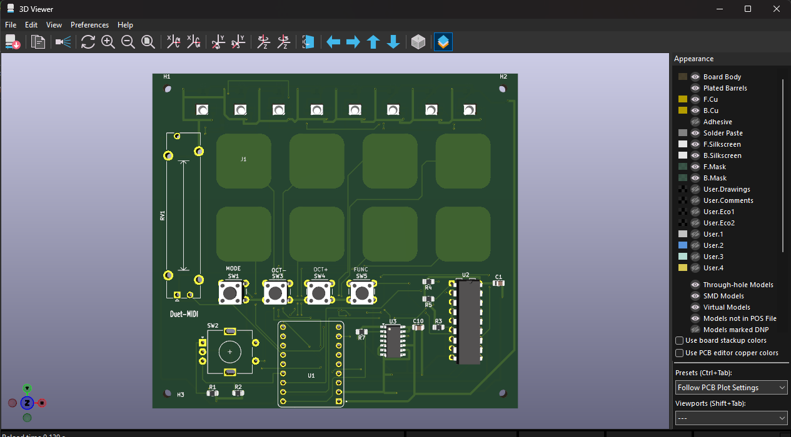
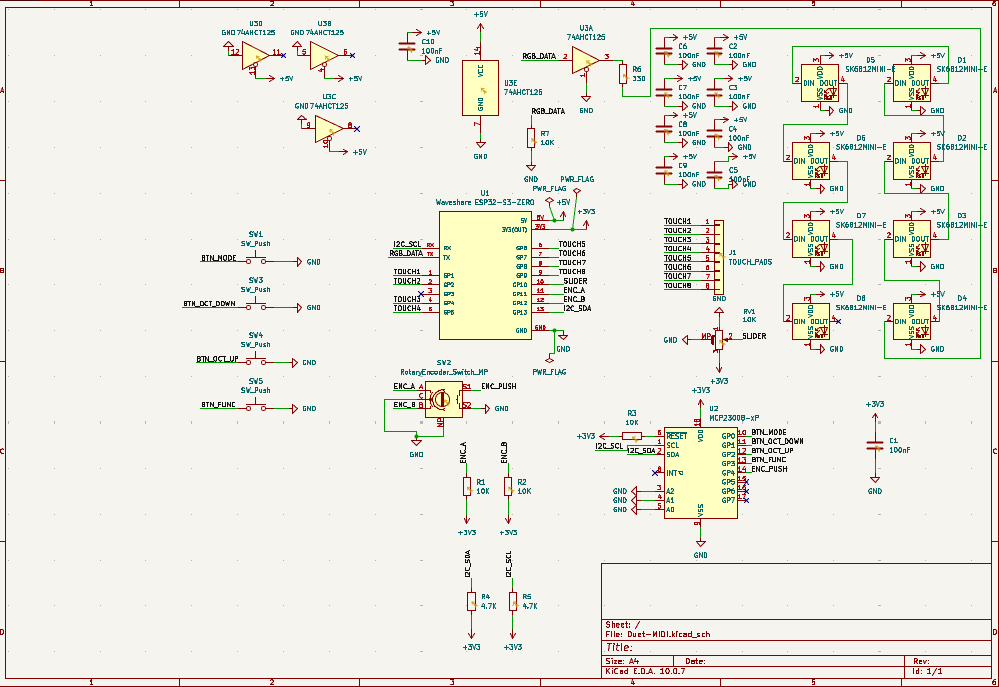
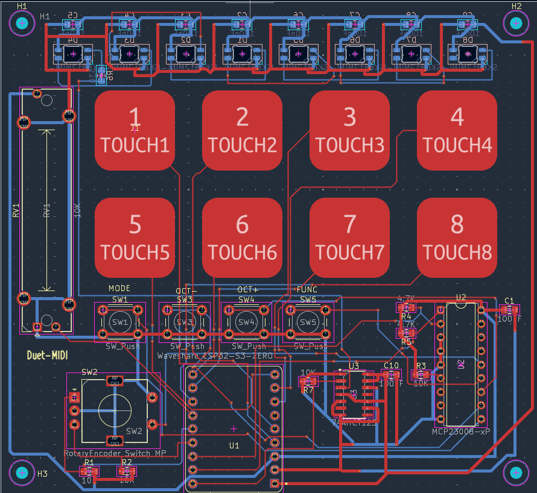

# Duet-MIDI

I wanted to make something I could use to play both melodies and drums without needing two separate controllers. That is where Duet-MIDI started: eight touch pads, two modes, and a few extra controls to make it more fun to play.

This is my project for **Hack Club Half Life, Week 3: Music**. The schematic and PCB layout are finished, the Gerbers have been exported and checked, and the first enclosure version is modeled in Onshape. I have also prepared a first CircuitPython firmware version. I still need to print it, build the board, and test the firmware, so the pictures below are from KiCad, not a working prototype.

## What I want it to do

In melody mode, the eight pads will play notes from a scale, with buttons to move up or down an octave. In drum mode, the same pads will trigger different drum sounds. I added a mode button so I can switch between them instead of having to choose just one idea.

There is also a slider, a rotary encoder with a push switch, and a function button. Their exact MIDI assignments are still something I need to work out in the firmware. Eight RGB LEDs will give feedback for the mode and the pads being played.

It will connect to a computer over USB for both power and MIDI. The sound will come from a software instrument or drum sampler on the computer.

## The board

The PCB is **100 × 91.75 mm**, with two copper layers and four M2 mounting holes. I kept the touch pads in two rows of four, put the slider on the left, and placed the other controls below the pads. The RGB LEDs sit on the back and shine through eight openings near the top.

| Part | What it does |
| --- | --- |
| Waveshare ESP32-S3-Zero | USB connection and main controller |
| 8 capacitive touch pads | Note and drum inputs |
| MCP23008 | Reads the four buttons and the encoder push switch |
| Rotary encoder and 10 kΩ slider | Additional MIDI controls |
| 8 SK6812MINI-E RGB LEDs | Visual feedback |
| 74AHCT125 | Converts the RGB data signal from 3.3 V to 5 V |

## Getting the layout finished

Routing took a lot of small fixes. I had to work around the touch pads, connect the LEDs in the right order, and keep checking the remaining unconnected items as I went. Eventually the routing check reached zero violations and zero unconnected items with schematic parity turned off. That was a really nice point to reach after seeing the list slowly go down.

I then moved the reference text that was outside the board, added the control labels, and checked the exported copper, outline, and drill layers in Gerber Viewer.

[Routing check screenshot](docs/images/routing-drc.png) · [Back view](docs/images/pcb-back-3d.png)

The routing screenshot is from before the final text cleanup. Five DRC checks were disabled in that run; the details and the remaining manufacturing checks are in [pcb/README.md](pcb/README.md). The electrical behavior still needs to be tested on real hardware.

## The enclosure

I wanted a case I could open again, with the touch area accessible and a window underneath to show part of the PCB. V1 has a separate lid, four button extensions, a knob for the encoder, and a grip for the slider. The lid uses the same four M2 mounting positions as the board.

I had to lower the ESP32 mounting height to keep the case even across the top. I also adjusted the small control sockets and checked the slider at the center and both ends. The next step is a real fit test, starting with the small pieces before printing the whole enclosure.

[Enclosure files and assembly notes](cad/README.md) — includes individual STEP and STL parts plus a reference assembly. The bottom window is designed for separate 1 mm acrylic.

## Files

- [KiCad project](pcb/Duet-MIDI.kicad_pro), [schematic](pcb/Duet-MIDI.kicad_sch), and [PCB](pcb/Duet-MIDI.kicad_pcb).
- [Gerber ZIP](pcb/Duet-MIDI-Gerbers.zip) and [individual manufacturing files](pcb/gerbers/).
- [PCB notes and library setup](pcb/README.md).
- [CircuitPython firmware V1](firmware/), [enclosure V1](cad/), and [development journal](JOURNAL.md).
- [BOM draft](BOM.csv), with quantities extracted from the PCB. Exact parts, suppliers and prices are still pending; see [BOM notes](docs/BOM-notes.md).

To open the design, download the repository and open `pcb/Duet-MIDI.kicad_pro` in **KiCad 10**. The custom touch-pad footprint and the Hack Club libraries used by the design are included with project-relative paths.

## Firmware progress

The first CircuitPython version now includes both pad modes, octave buttons, a panic button, slider modulation, encoder volume with push-to-reset, and RGB feedback. Desktop tests cover the note and control logic, but I have not tested USB MIDI or any of the physical controls on the board yet. Touch thresholds, encoder settings, lighting and power use still need checking.

## What is next

The next steps are to finish the parts list, confirm the manufacturing limits, print and fit-test enclosure V1, and test the first firmware version on hardware. After assembly, I will need to test USB MIDI, calibrate the touch pads, and check the buttons, slider, encoder, and lighting together.

One thing still to confirm before ordering is the **0.20 mm copper clearance around the internal LED cutouts**. The LED brightness and USB power budget also need to be handled before running the assembled board.

## References

I started from [Kai Pereira's MIDI Keypad guide](https://github.com/KaiPereira/MIDI-Keypad) and developed this layout around the two-mode idea and the extra controls. The Waveshare symbol and footprint come from [Hackclub KiCad Libraries](https://github.com/KaiPereira/Hackclub-KiCad-Libraries); see [the attribution notes](pcb/libraries/README.md).

Project by **Nash Andrés Rivera Ramírez**.
